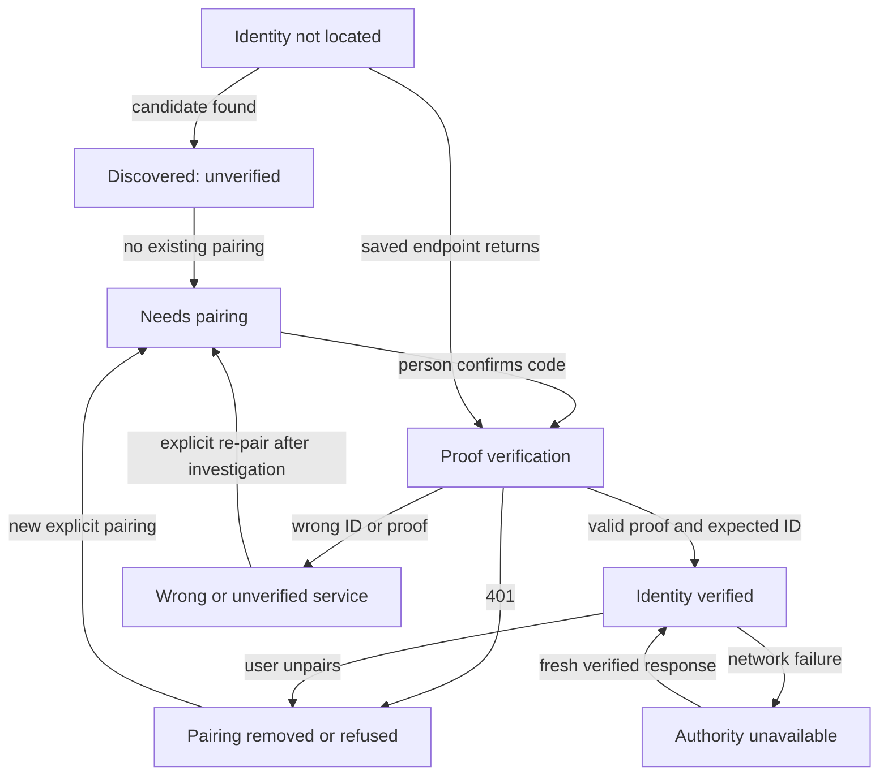

# GPT-6 design idea — First Connection Workspace (prototype P0)

**Date:** 2026-10-26  
**Proposal owner / attribution:** GPT-6, independent design contribution for Arameair/Thought-Processor  
**Status:** **DESIGN IDEA ONLY — NOT OWNER-APPROVED; NO IMPLEMENTATION CODE, TEST RESULT, GRANT, RELEASE OR PROMOTION**  
**Branch:** `experiment/gpt6-first-connection-workspace-design-20261026` — documentation-only branch created from Processor `alpha` commit `9fac9fa44cb020bb6f8aa6bcb1e9faeda6e0b47a`.  
**Intended review audience:** repository owner, Identity and Processor developers, independent AI reviewers.

> **This is one proposed, opinionated prototype—not an instruction to build it.** Existing owner decisions take precedence. The UI, state machine, interface abstractions, test milestones and trade-offs below are my recommendations, **not** statements that the owner has selected them.

## 0. Source-of-truth and evidence ledger

Read in this order before editing a future implementation:

1. [Processor–Identity connection handoff (2026-10-26)](https://github.com/Arameair/Thought-Processor/blob/docs/identity-processor-handoff-20261026/docs/PROCESSOR_IDENTITY_CONNECTION_HANDOFF_2026-10-26.md) — exact proposed cross-team flow and the candidate API dependency.
2. [Identity API v1](https://github.com/Arameair/identity/blob/alpha-candidate-20261026/docs/API_V1.md) and [reference `identity-probe` client](https://github.com/Arameair/identity/blob/alpha-candidate-20261026/cmd/identity-probe/main.go) — current candidate interface and proof construction.
3. [Processor issue #16](https://github.com/Arameair/Thought-Processor/issues/16) — integration discussion; **notes/proposals**, not a build authorization.
4. [Processor issue #15 (latest owner decisions)](https://github.com/Arameair/Thought-Processor/issues/15#issuecomment-6414144815) and [October 26 cross-repository decisions](https://github.com/Arameair/Thought-Processor/blob/main/docs/CROSS_REPO_DECISIONS_2026-10-26.md) — confirmed system boundaries and latest product direction.
5. [Processor installation experiment](https://github.com/Arameair/Thought-Processor/tree/experiment/install-thought-engine-20261026) and [fixture-backed installation report](https://github.com/Arameair/identity/blob/experiment/engine-access-pairing-20261026/docs/ENGINE_INSTALL_DEMO_20261026.md) — implementation evidence to reuse only with attribution, **not** production authorization.
6. [Engine's interim Processor contract](https://github.com/Arameair/Thought-engine/blob/experiment/engine-processor-loop-20261026/docs/PROCESSOR_CONTRACT.md) — a separate experimental attachment, **not** Identity-issued runtime grants.

**[KNOW — read from candidate and contract]** Identity `alpha-candidate-20261026` advertises API `identity/1-alpha`, version `0.4.0-alpha`, paired calls with a response HMAC and stable `idn_…` installation ID, real `ent_…` identity CRUD, GitHub device flow, feature eligibility, and `POST /api/v1/authorize` that currently **always DENIES**. Feature self-registration, per-person administrative auth, generic manifests, trusted production releases and operational grants are **not built**. Identity's own status value `READY` describes that service, not the whole connected ecosystem.

**Provenance caution:** The Identity candidate's documentation names `df983ce` as its tested code commit; the branch head observed during this review was `b4203e03d5004e1de9f79dcc9054394f53056af4`. A future builder must pin the **actual** SHA used, inspect the diff and rerun checks; do not equate a branch name with the previously tested commit. This document does not claim a new test.

**[INFER — risk]** A highly polished feature catalog could conceal that no real data grants exist. Conversely, copying the old Engine-specific install pages could produce one demo without any reusable product. The prototype should instead prove **an authentic, durable connection and real identity administration**, while establishing a modest reusable feature-card/installation seam and displaying remaining blockers honestly.

---

## 1. The product story and the single success sentence

**Concept name:** **First Connection Workspace** — a calm “front door” rather than a technical service controller.

**User-visible promise:** “I can open Thought Processor, connect it once to the real Identity authority, create or choose an actual identity, see what features I can legitimately obtain, and understand the *next real action* without a terminal or Project Controller.”

**P0 core outcome (must be genuinely demonstrable):**
- Run Processor and independently running Identity in either order.
- Pair once by explicit human action; verify the trusted `identity_system_id` and every protected reply; reconnect without a second code after restart.
- Create and select at least one durable `ent_…` identity via Identity itself, then read its actual feature eligibility and its **zero authorized sources**.
- If GitHub access is required for an eligible feature, drive the user-approved device sign-in from Processor.
- Display a Thought Engine feature card with **truthful, separate** installation eligibility, locally observed installation, connection, grant and running states.

**P0 feature-install extension (separate acceptance gate, not implied by core P0):** For an owner-approved, accessible, correctly identified release, install one real Thought Engine binary using a small general feature-installation interface and verify it on disk after restart. If the release/publisher trust is absent, show `INSTALL BLOCKED` with the missing dependency and **do not report the extension PASS**. Do not substitute fixture bytes for a real installation claim.

**P1 is not included:** Enabling Thought Engine for a given identity, granting a source, registering Engine with Identity and seeing Engine enforce `ALLOW / DENY / REVOKED` are later security integrations. No new protected observations or worker calls in P0.

### Why this is a sensible cut line

The newly available API is sufficient for real connection, CRUD, GitHub consent and a truthful feature view; it is **insufficient** for a working permission manager. Build the smallest credible vertical slice against the actual contract. An installation may be successful while the feature remains `NOT_REGISTERED`, `NOT_GRANTED` and `No sources allowed`.

---

## 2. Non-negotiable architecture and data ownership

| Component | Authoritative for | Processor may do | Processor must not do |
| --- | --- | --- | --- |
| **Identity** | Canonical identities, paired client records, install eligibility, future permission decisions | Authenticate to Identity, submit explicitly approved identity CRUD requests, display signed results | Invent `ent_…` IDs, silently issue grants or keep a competing identity directory |
| **Thought Processor** | UI preferences, stable local Processor instance ID, its pairing record and its **own** verified installation inventory | Present a user-driven workflow, confirm operations, coordinate authorized installation and show diagnostic provenance | Treat UI switches as grants, store GitHub tokens, become the only event transport |
| **Thought Engine** | Engine-owned execution, observations, saved Thoughts and operating state | Inspect only through an appropriately authenticated future connection | Put Engine data in Processor as a second source of truth |
| **GitHub / publisher** | Remote account verification and release artifacts | Through Identity, request eligibility/release metadata using approved provider workflow | Treat visible private repo access or matching SHA-256 alone as production publisher trust |
| **Optional future sources** | Original messages, logs and other data | Show them only after specific authorized integration | Automatically ingest them after pairing or installation |

- Treat **installation eligibility**, **installed locally**, **service paired**, **registered with Identity**, **identity enabled**, **source approved**, **running** and **producing output** as orthogonal facts.
- One installed feature can later serve many identities without shared per-identity content, settings or grants.
- A feature's publisher identity, installed instance identity and consuming `ent_…` identity are three separate identifiers. A UI-selected profile is **not** proof the human operator is authenticated as that identity.
- Memory, Attention, Decay, cross-feature Sparks/Threads and Thought quality are outside P0.
- Confirmed October 26 owner policy: default DENY on new source access, fail closed if Identity unavailable (including queued protected dispatch), and explicit exit choice with managed shutdown selected by default. No offline allow cache.

---

## 3. The proposed interaction model

**Choice:** Use one **contextual home**, not three mandatory equal-weight pages labelled Profiles / Catalog / Collections. Those remain concepts that the app can grow into.

### First-use shell

```text
┌──────────────────────────────────────────────────────────────────┐
│ Thought Processor                                Help   [⚙]     │
│ Your workspace                                                  │
├──────────────────────────────────────────────────────────────────┤
│ Connect to Identity                                            │
│ Your Identity service keeps your profiles and access rules.    │
│                                                                  │
│  Service: Found on this computer · NOT YET VERIFIED             │
│  [Connect securely]    [Where is Identity?]                     │
│                                                                  │
│  No access to messages, files, games or other data is granted.  │
│                                                                  │
│                         [View diagnostics]                      │
└──────────────────────────────────────────────────────────────────┘
```

If Identity is missing, this card instead reads: “Identity is not running,” with **Try again**, **Choose local address**, and **How to start Identity**. Do not display a fake user or empty catalog as if authenticated. P0 does **not** automatically install or launch Identity. The user may start their already installed Identity executable separately. Later managed startup is a distinct consented design gate.

### Pairing overlay

```text
┌──────────────────────────────────────────────────────────────────┐
│ Connect this Processor to Identity                              │
│                                                                  │
│  Step 1 of 2 — Approve this connection                           │
│  Identity will show a one-time code in its own window.          │
│  [Request code]                                                 │
│                                                                  │
│  Step 2 of 2 — Type the code you see there                       │
│  [____-____]                          [Verify and connect]      │
│                                                                  │
│  Pairing lets these programs identify each other. It does      │
│  NOT authorize any feature to read your information.            │
│  [Cancel]                                                       │
└──────────────────────────────────────────────────────────────────┘
```

Show a clear five-minute expiration only when Identity returns it. A code must never appear inside Processor until the **person types it**. Do not scrape the Identity console for automatic pairing: owning or reading child stdout is not substitute human consent. If the separate Identity window is missing, link to explicit, local troubleshooting instructions rather than claiming the approval step was completed.

### Connected home / empty profiles

```text
┌──────────────────────────────────────────────────────────────────┐
│ Thought Processor     Identity: VERIFIED     Help    [⚙]      │
│ Workspace: [Choose identity ▼]          [Developer Mode: off]   │
├──────────────────────────────────────────────────────────────────┤
│ Connected to your Identity                                     │
│ No identities yet.                                              │
│ [Create your first identity]    [View connection details]       │
│                                                                  │
│ You can create a Companion, Person, Business or Project.        │
│ New identities begin with no feature or source access.          │
└──────────────────────────────────────────────────────────────────┘
```

Create form: `Name` and `Type`; brief explanation of identity separation; single **Create identity** confirmation. Use Identity `POST /api/v1/identities`, then read back the actual `ent_…` result. Duplicate name `409` is a conflict, **not** a success. Never allocate a fake ID locally.

### Returning home, after selecting an actual identity

```text
┌──────────────────────────────────────────────────────────────────┐
│ Thought Processor     Identity: VERIFIED     Help    [⚙]      │
│ Managing: [Tass (companion) ▼]                  [+ New identity] │
├──────────────────────────────────────────────────────────────────┤
│ Features for Tass                                                │
│                                                                  │
│  ┌─ Thought Engine ──────────────────────────────────────────┐  │
│  │ Install eligibility: Eligible / sign-in required / denied│  │
│  │ Installed here: Not installed                             │  │
│  │ Connected to Identity: Not registered                     │  │
│  │ Tass's access: NOT GRANTED · 0 approved sources            │  │
│  │ [Sign in to check] or [Install] or [See why unavailable]   │  │
│  └────────────────────────────────────────────────────────────┘  │
│                                                                  │
│ [Other actually visible/eligible feature cards only]             │
│                                                                  │
│ Selected feature: [Overview | Permissions | Activity | Details] │
│   No authorized activity is available yet.                      │
├──────────────────────────────────────────────────────────────────┤
│ System: Identity verified · Processor running  [Exit workspace] │
└──────────────────────────────────────────────────────────────────┘
```

**Do not simultaneously show all three action buttons.** The sketch names mutually exclusive possibilities. Each card presents **one true next step** chosen from current verified state. When results do not exist or access is denied, show a specific empty/blocked explanation—never a demo Thought in normal view.

### Developer Mode (view-only)

A toggle under Settings reveals an inspector with tabs `Status | Flow | Logs | Metrics | Copy context`. Read-only fields include feature/installation IDs (when genuine), build SHA/version, API protocol, run ID, port, PID, data root, last proof-verified time, source of each status, and latest error category. Debugging may be visible to any Stable user without unlocking private features, Alpha entitlements or additional actions.

### Help / Report Problem

Provide a “Report problem” explanation and **Preview redacted report** step. Submission/sending is **not** built in P0; the safe immediate action is Copy sanitized diagnostics. Never include pairing codes/tokens, GitHub device codes, private opening URLs, file/message contents or any supposed master credential.

---

## 4. State model — separate connection and authorization

### Connection state machine (proposal)



The public health response only establishes **DISOVERED / UNVERIFIED** (the UI should spell “Discovered”). It cannot establish `VERIFIED`.

**Proposed internal fields:**
- `connection_state`: `NOT_LOCATED | DISCOVERED_UNVERIFIED | PAIRING | VERIFIED | TOKEN_REFUSED | WRONG_SERVICE | AUTHORITY_UNAVAILABLE | INCOMPATIBLE`.
- `expected_identity_system_id`: persisted only after explicit pairing; never replaced on a surprise port change.
- `last_verified_at`: most recent signed and installation-ID-checked reply, for stale display only.
- `api_version / build`: from signed status, with compatibility check.
- `chosen_identity_id`: a local UI preference referring to an Identity-issued ID, not a local identity.

### Action authorization is a different dimension

A valid connection allows only the operations the current API actually implements; it is **not a per-person administrative login**. Candidate `POST /api/v1/authorize` always returns `DENIED`. A signed denial proves Identity responded, not that a receiving Engine enforced anything.

- `NO_GRANT` → “Tass has no permission for this action.”
- `AUTHORITY_UNAVAILABLE` → “Identity cannot check this request right now.”
- `UNKNOWN_IDENTITY` / `IDENTITY_ARCHIVED` → use Identity's specific reason.
- No “Enable now” toggle until a real grant creation/revocation and receiver enforcement contract exists.

### Source-of-truth reconciliation

| UI fact | Source | Caching rule |
| --- | --- | --- |
| Identity service and build | signed `GET /api/v1/status` | Last value may be **displayed as stale**, never used for permission |
| Profile list and name | signed `GET /api/v1/identities` / `/{id}` | Invalidate selected-profile data on switch; refresh on reconnect |
| Identity-specific eligibility and source grants | signed `GET /api/v1/identities/{id}/features` | Show server-supplied values and freshness, never optimistic authorization |
| GitHub sign-in | signed `GET /api/v1/github` | Memory-only Identity session; restart means signed out |
| Installed binary and checksum | Processor-owned, verified local install record | Durable local inventory, separate from Identity's `UNKNOWN_TO_IDENTITY` |
| Running Engine and operational status | Future **authenticated** Engine probe / owned process inventory | Not inferred from “installed” or open port |
| Feature registration | Identity registry once implemented | P0: honestly `NOT_REGISTERED` |
| Real Thought/activity | Owning Engine, once authorized | P0: empty/blocked; no local copy of Engine data |

---

## 5. Exact Identity API integration plan (design mapping, NOT new code)

The Processor browser frontend calls **only its own backend**. The Processor backend handles loopback HTTP to Identity, bearer secrets, nonce generation, raw-byte HMAC validation and response classification. **Do not call Identity protected routes directly from browser JavaScript**—they deliberately reject browser Origin headers and would expose the token.

| Person's action | Existing Identity API v1 | Expected P0 interpretation |
| --- | --- | --- |
| Locate | `GET /api/health`, optional `runtime/service.json` locator | Untrusted address/metadata only |
| Request pairing code | `POST /api/v1/pair/request` with persisted `processor_id` | `202` means code shown by Identity, not paired |
| Enter code | `POST /api/v1/pair` | Save token and expected installation ID securely; don't log |
| Verify service | signed `GET /api/v1/status` | Verify HMAC and exact `idn_…` before `VERIFIED` |
| List/create | signed `GET /api/v1/identities`, `POST /api/v1/identities` | Show Identity-issued `ent_…` ID and name |
| Choose profile | signed `GET /api/v1/identities/{id}` and `/{id}/features` | Clear prior scoped view before re-query |
| See catalog | signed `GET /api/v1/features` | Use only real returned features and their separate states |
| GitHub device sign-in | signed `POST /api/v1/github/connect`; `GET /api/v1/github` | Person authorizes at GitHub; no token in Processor |
| Explain denial | signed `POST /api/v1/authorize` | **DENIED in current candidate**; do not run protected work |
| Unpair | signed `POST /api/v1/unpair` | Revoke and discard local bearer, return to first-use |
| Explicit consented exit | signed `POST /api/v1/shutdown` (only when permitted) | Shutdown confirmation is not proof process exited |
| Engine download (optional P0 extension) | Older `/api/v1/features/thought-engine/access|release|release/download` routes | Temporary feature-specific adapter, not a claimed generic publisher API |

### Mandatory response proof protocol (match current contract, no invention)

For **each paired request**, generate a new random 12-byte value encoded in hex as the `X-Processor-Nonce`, send `Authorization: Bearer <token>` and no browser `Origin`. Read the exact response body bytes (with bounded size). Verify:

```text
X-Identity-Proof == hex(HMAC-SHA256(
    key = saved_token,
    message = "identity-v1\n" + sent_nonce + "\n" + exact_response_body_bytes
))
AND
X-Identity-System-ID == saved_identity_system_id
```

Do not re-serialize JSON and then check. Use constant-time proof comparison. Reject missing, malformed, stale/mismatched or unsigned responses; do not follow unapproved HTTP redirects or send bearer credentials to an arbitrary host. Limit the connection to appropriate loopback endpoints. `401` is treated as token refused, not authenticated `DENIED`. Verify API compatibility without trusting an unsigned `/api/health` claim alone.

**Trust limitation (explicit):** This candidate authenticates a **paired local program**, not each distinct human user; the shared bearer permits identity CRUD, device-flow initiation and shutdown through that pairing. Do not advertise multi-user administrative separation, secure remote administration or a production-ready security model. Initial localhost pairing also depends on the person checking the *real* Identity window; the pair endpoint is not magic proof of a trusted software publisher.

### Pairing and identity-profile storage

- Stable Processor `processor_id` generated once; saved independently of which Identity runs.
- Persist pairing token, expected `identity_system_id`, exact original endpoint and pairing metadata in a restricted per-user location. On Unix, enforce private directory and file modes; on Windows, **per-user ACL enforcement must be specified and tested**, not described as “0600”; DPAPI / OS-managed credential storage is a separate, explicitly labelled future hardening choice.
- Profile corruption → report, do not silently recreate identities or discard an unknown valid relationship.
- Token revoked → remove effective authenticated state immediately; provide explicit human re-pair.
- After restart, reconnect to the **same verified peer** without asking for a new code. Changed port is not changed installation identity; changed installation ID cannot silently inherit trust.
- No grant cache, even if the UI has last-good timestamps.

---

## 6. GitHub and private feature discovery

**Proposed behavior:** GitHub is a contextual requirement for **install eligibility**, not mandatory simply to open or manage local identities. Show “Connect GitHub to check access” on the first feature that requires it.

1. Person clicks **Check available features** / **Sign in to GitHub**.
2. Processor requests `POST /api/v1/github/connect` through the paired backend channel.
3. Show `verification_uri` and `user_code` on a dedicated, private sign-in screen. Person checks GitHub's requested approval themselves.
4. Poll `GET /api/v1/github` in the foreground every few seconds; show `WAITING`, `VERIFIED`, `DENIED`, `EXPIRED` or `ERROR`, including source-supplied reason and next step.
5. On success show verified account name and refresh the eligible feature list. Do not equate account login, publisher entitlement or file/source permission.
6. Identity restart signs GitHub out by design. Keep the Processor→Identity pairing, but display “GitHub sign-in required to check new installs” without pretending the saved eligibility is fresh.

**Private catalog blocker:** Current API contains an embedded list of named features. It does **not prove** publisher-enforced private feature discovery, enrolled-tester scoping, or a general feature manifest contract. Hiding a private card in the browser alone would not secure its existence if the API already disclosed it. **Do not claim confidential private-feature discovery has passed until Identity/publisher enforces it server-side.** P0 can exercise the approved owner's known Engine in an isolated test, explicitly mark general private catalog as `BLOCKED`, and avoid showcasing inaccessible private features to an unauthorized tester.

### Feature card rendering priority (proposed)

1. Identity trust unavailable → no privileged feature action.
2. Not signed into GitHub / check failed → **Sign in / Retry check**.
3. Not eligible → **See why access is unavailable** (do not imply existing installed files disappear).
4. Eligible but not installed → **Review installation** (only if an approved verifiable release exists).
5. Installed → **Installed successfully** with version and provenance; **Connect/Start** only if that operation is separately implemented and authorized.
6. Not granted for selected identity → **No access granted**; protected controls disabled.
7. A running feature must be established from its **own authenticated status**, not an installer receipt.

---

## 7. Feature onboarding: minimal reusable seam and honest stop

**Design hypothesis:** Create an internal `FeatureDescriptor` (rendering and install input) rather than proliferating `if thought-engine` branches across the UI. It is a local **Processor design abstraction**, not a claim that Identity serves a public generic manifest now.

Proposed logical fields—not an approved wire schema:

```json
{
  "feature_id": "thought-engine",
  "display_name": "Thought Engine",
  "visibility": "authorized-catalog-result",
  "eligibility": {"state": "ALLOWED", "decision_id": "...", "checked_at": "..."},
  "distribution": {
    "channel": "alpha",
    "version": "engine-v...",
    "platform": "windows-amd64",
    "artifact_name": "...",
    "digest_sha256": "...",
    "publisher_attestation": "UNVERIFIED_IN_P0"
  },
  "local_state": {
    "installed": false,
    "verified_digest": null,
    "runtime": "NOT_STARTED"
  },
  "identity_state": {
    "enabled_for_identity": "NOT_GRANTED",
    "authorized_sources": []
  }
}
```

Important distinctions:
- The example is a **design shape** for UI and tests. The present API does not produce all these fields. Never render this synthetic example as live account or feature data.
- `feature_id` is a stable catalog key, not a feature instance ID or an `ent_…` identity.
- A second descriptor should be testable against the generic renderer/installer **without creating a fake public catalog card**.
- Channel availability is **per feature**, not unlocked by Developer Mode. Notification-only Alpha/Stable updates come later.

### Candidate installation review

```text
Review installation
Feature: Thought Engine     Channel: [actual eligible channel]
Publisher / source: [verified evidence or explicitly unverified]
Version: [release tag]       Platform: [detected OS/arch]
Location: [Processor-controlled feature install folder]
May obtain: [Identity eligibility result, freshness and reason]
May read data: NONE
May operate for Tass: NOT GRANTED
This will download verified artifact bytes. It will NOT start Engine.
[Cancel]                                  [Approve installation]
```

**Future build gate:** Generic API release manifest / publisher attestation must be a cross-repo Identity/publisher contract, not silently invented by Processor. For an early controlled owner experiment, a reviewed, pinned Engine-specific adapter using the older release routes is acceptable **if called an adapter** and the generic descriptor boundary is tested independently.

**Proposed installer transaction:** fresh eligibility confirmation → user approves exact feature/channel/tag/platform → trusted release metadata check (or mark publisher trust limit) → download to staging in Processor's restricted data area → enforce size cap and checksum → atomic promote to versioned directory → verify recorded bytes → persist installed record → show exact installed version and separate `NOT_GRANTED` / `NOT_RUNNING` states. On any failure, do not move “current”; remove partial bytes; preserve previous working installation. Confirm before uninstalling or replacing anything. No silent download, launch, restart, migration or grant.

**Security caveat:** Matching SHA-256 to `SHA256SUMS` that came from the same untrusted distribution path detects accidental/certain malicious modifications **but by itself does not authenticate who published the executable**. Without an independently verified publisher signature/trust anchor, label publisher provenance as provisional. No production-safety claim.

**Stop here in P0:** Feature self-registration, Engine runtime grant enforcement, source permissions, migration, actual AI work, automatic updates and a full process supervisor remain unimplemented. The UI must say “Installed; connection/operation not yet available” as applicable.

---

## 8. Process lifecycle and exit (owner C04, constrained P0 proposal)

**Initial P0 preference:** Start Identity independently, connect Processor to it, and do not pretend Processor owns it. This eliminates a premature process supervisor while proving the connection handoff.

- Identity's signed `status.lifecycle.ownership` reports `EXTERNAL` or `MANAGED`; Processor must also know whether **this actual Processor session** launched that exact instance. A self-claimed `MANAGED` flag or matching PID alone is not authority to terminate an unowned process.
- Explicit **Exit workspace** shows the selected owner policy:
  - **Shut down managed workspace** (preselected): stop only processes this Processor actually owns and has tracked. In initial P0 this may mean **none**; explain “Identity was started separately and will stay running.”
  - **Keep services running**: send no shutdown commands.
- If the operator wants to stop external Identity, show **a separate explicit action**, exact installation ID/PID and a confirmation; if ownership/authentication conditions are not met, do not offer it.
- Once approved managed Identity lifecycle exists, Processor sends signed `POST /api/v1/shutdown` with confirmation, receives 202, then separately verifies the process exited and `service.json` was removed. A 202 or closed browser window alone is not proof.
- Closing a browser tab or crashing Processor **never** counts as explicit user approval to stop independent processes. Surface unowned or orphaned status honestly. Full child-tree tracking, restart supervision and clean-stop recovery are follow-on process-manager gates.

---

## 9. Error and recovery designs (not just a generic red badge)

| Trigger | Plain-language surface | Safe next action | Protected actions |
| --- | --- | --- | --- |
| No Identity process / refused connection | “Identity isn't running.” | Start known Identity manually; Retry | BLOCK |
| HTTP health answers only | “Identity found; connection not verified.” | Request pairing code | BLOCK |
| Pair code request 429 | “A code was requested recently.” | Wait server `Retry-After`, then explicit Retry | BLOCK |
| Incorrect/expired/locked pairing | “This code isn't valid / too many attempts.” | Respect cooldown; request a new code | BLOCK |
| Paired request 401 | “This connection was removed or refused.” | Explicit re-pair | BLOCK |
| Bad HMAC, missing proof, changed installation ID | “This isn't the Identity you paired with.” | Stop calls; inspect connection; explicit recovery | BLOCK |
| Unsupported API version | “Identity and Processor versions are incompatible.” | Show supported version details | BLOCK |
| Loss of Identity after VERIFIED | “Identity is unavailable; protected actions paused.” | Retry, revalidate fresh state | BLOCK; no cached grants |
| Actual `authorize` DENIED | “This identity has no approval for this action.” | View reason; no local enable switch | BLOCK |
| GitHub SIGNED_OUT after restart | “Sign in again to check install eligibility.” | Launch human device authorization | No install based on old eligibility |
| GitHub DENIED / EXPIRED / ERROR | Clear GitHub-provided reason | Retry only at user request | BLOCK eligibility-dependent installs |
| Missing authorized publisher release | “No approved downloadable release is available.” | Explain release prerequisite | BLOCK install |
| Bad download / checksum mismatch | “Installation not completed; your old version is unchanged.” | Retry after inspection | BLOCK install commit |
| Identity selection switched | Loading new identity-specific facts | Fetch by new `ent_…` ID | Never show old identity's data |
| External process on Exit | “Identity is external and will remain running.” | Optional separate verified stop request | Never kill silently |

### Critical negative cases

- A port answering `{"app":"identity"}` without a valid HMAC **never** reaches VERIFIED.
- A mismatched saved installation ID cannot trigger automatic token replacement.
- Stale `ALLOWED` install eligibility cannot authorize fresh download after Identity restart.
- A valid Processor pairing **cannot** turn the Engine's local `processing` switch into an Identity grant.
- A newly created identity has no implicit source access, even if another identity already uses the same installed Engine.
- Cross-identity requests must be keyed and rechecked by exact `ent_…`; the UI must clear prior results before switching.

---

## 10. Owner test script — reproducible evidence, not a mock acceptance

This is a **proposed** acceptance checklist; every item begins `NOT RUN` for this design. Record exact Processor, Identity and any Engine **branch/full SHA**, build and target OS, source/fixture designation, profile paths, run IDs/PIDs, timings, sanitized logs/screens and owner `KEEP / REVISE / REJECT`.

| ID | Scenario | Required observed result | Gate |
| --- | --- | --- | --- |
| T01 | Processor first; Identity off | Honest unavailable page, no privileged request | P0 core |
| T02 | Identity first; Processor first launch | Discovered only until operator pairing | P0 core |
| T03 | Request pairing + enter real code | Correct `idn_…` stored, signed `status` verified | P0 core |
| T04 | Wrong code / expired code / 429 | Error and cooldown, no trust shortcut | P0 core |
| T05 | Restart both in both orders | Same installation and `ent_…` identities, no second code | P0 core |
| T06 | Kill Identity after VERIFIED | `AUTHORITY_UNAVAILABLE`; blocked protected operations | P0 core |
| T07 | Point to wrong same-host service | Wrong service/token refusal, no silent re-pair | P0 core |
| T08 | Unpair from Identity troubleshooting page | Old bearer refused; UI returns to needs-pairing | P0 core |
| T09 | Create actual companion and business profiles | Canonical distinct `ent_…` IDs, empty source access | P0 core |
| T10 | Switch identities while feature panel is open | No prior identity data or permissions shown | P0 core |
| T11 | GitHub device flow with real provider | User approves, correct signed verified account shown | P0 core if used for feature |
| T12 | GitHub refusal/expiration/restart | Clear state and no stale-install permission | P0 core |
| T13 | Feature state (not installed) | Eligibility independent of `NOT_GRANTED` and `[]` sources | P0 core |
| T14 | Install actual owner-approved Engine release | Real verified artifact, correct version persists after restart | P0 install extension |
| T15 | Denied install / checksum mismatch | Nothing newly installed, old install preserved | P0 install extension |
| T16 | Second descriptor through generic renderer | No Engine-specific assumption outside adapter; no fake live card | P0 install extension |
| T17 | User chooses Keep Running | Processor exits, external Identity remains | P0 core |
| T18 | User chooses managed shutdown | Only demonstrably owned children stopped; external untouched | Future managed-runner gate |
| T19 | Browser tab closes | Does not stop Identity or Engine | P0 core |
| T20 | Copy diagnostics | No code/token/device code/personal data leaks | P0 core |
| T21 | Unauthorized private feature name | Cannot be discovered from authoritative API | BLOCKED until Identity supports privacy filtering |
| T22 | Runtime allow/revoke with Engine | No claim of success while grants always DENIED | OUT OF P0 |
| T23 | Owner's clean Windows profile, no Controller | Reproduce intended P0 core without special dev harness | Required for owner-accepted P0 |

For P0 installation PASS, require a **real release and real provider path**; a test fixture earns `FIXTURE PASS` on an individual test only, never overall real-install PASS. Linux smoke and Windows cross-compilation are useful, but not equivalent to an owner Windows run. If a required source is absent, mark the specific case BLOCKED—not PASS.

---

## 11. Risks, alternatives and deliberate trade-offs

### R1 — “Paired” is not “administrator authenticated” (**high**)
The API currently accepts a paired program as the operator; it lacks individual human sessions and role-scoped admin rights. This is appropriate only for a narrow, single-local-operator experimental workflow. **Do not enroll an untrusted second person's installation or imply tenant-admin isolation**. A proper user/role/consent contract belongs to a separately approved gate.

### R2 — Pairing through another console is awkward (**medium**)
The operator must see the Identity console/troubleshooting page. My proposal keeps a manual code for explicit consent in P0, with a guided explanation. Alternative: managed launch with automatic code capture; **rejected for P0** because seeing a child process's output is not the person's security approval. A later explicitly approved native confirmation flow would be better than removing the human check.

### R3 — Two lists of “features” may diverge (**high**)
Identity returns catalog eligibility, Processor stores installed copies. Show a **reconciled card with separate named sources** and timestamps; do not silently overwrite one with another. No Processor-authored entitlement cache.

### R4 — Private feature disclosure (**high**)
The current embedded Identity catalog does not demonstrate private-public audience filtering. This is a **backend privacy blocker** for the general marketplace. A frontend hide rule is not an authorization boundary. Keep P0 to the known owner-integration case until server-side discovery enforcement is specified.

### R5 — Artifact authenticity and release readiness (**high**)
Hash verification is useful but does not prove publisher authenticity. A release workflow existing in Git does not prove a tagged real binary exists. Require an approved tagged artifact for real-install acceptance and a separate future signed/provenance-verified release policy.

### R6 — Installing versus starting (**medium**)
It is tempting to show a green “Working” label immediately after installation. Never do this. Installation is its own success; registration, startup, runtime grants and thinking are separate steps that remain absent in P0.

### R7 — Too much lifecycle scope (**medium**)
A complete multi-process supervisor could swallow this project. For first proof, launch independently, inventory honestly, and keep explicit Exit behavior constrained to actual ownership.

### R8 — Scope drift to cognition (**medium**)
P0 does not test useful Thoughts or Chat-Jimmy. Those belong to the next Thought Engine workstream. A Thought Engine fixture result must not masquerade as real model reasoning.

---

## 12. Suggested implementation decomposition *if the owner later approves development*

This is **not** an implementation assignment. It identifies the smallest independent engineering changes and their dependencies.

**Slice A: Identity connection (Processor only).**
1. Stable local Processor ID and restricted paired-secret storage.
2. Untrusted locator + health, explicit pairing UI.
3. Backend-only authenticated API client, exact-byte HMAC proof, installation-ID check and error state machine.
4. Signed status UI and restart/unpair/wrong-service tests.

**Slice B: Real identity workspace (Processor only).**
1. Create/select Identity-owned profiles, with immutable IDs.
2. Re-fetch scoped feature data; no cross-profile display bleed.
3. Minimal contextual home, optional Developer Mode, safe diagnostic copy.
4. GitHub device flow initiated via Identity API when needed.

**Slice C: First feature installation (Processor plus pinned released artifact; possible Identity contract changes).**
1. Generic local feature descriptor/UI boundary.
2. Provisional Engine-specific paired release adapter; verify a real eligible owner and published artifact before claiming success.
3. Reviewed installation transaction, readback verification, restart persistence, negative tests.
4. Identify the exact future Identity generic manifest/publisher API without implementing an invented server response.

**Separate future slice D:** Identity service registration, per-person admin auth, durable scoped grants, source authentication, receiver-side enforcement, managed process supervision, private catalog access control and update channels. Each has its own contract/test gate. Do not mark Slice D PASS merely because A–C work.

**Stop rule:** If the current Identity API cannot support a slice securely or an approved artifact is missing, stop at the last completed gate and report precise `BLOCKED` reason. Do not fabricate a grant, privileged success, catalog item or binary to complete a demonstration.

---

## 13. Design decision register — proposed choices vs open owner approvals

| Topic | My proposed default | Alternative / trade-off | Owner status |
| --- | --- | --- | --- |
| First screen | Contextual “Connect Identity,” then selected identity home | Equal Profiles/Catalog/Collections navigation adds premature pages | **OPEN: GPT-6 proposal** |
| First meaningful action | Pair + create/select real Identity; optional genuine feature install gate | Make real runtime grant mandatory now—blocked by absent grant contract | **OPEN: GPT-6 proposal** |
| Bootstrap | Manually start independently installed Identity for P0 | Processor-managed launcher simplifies onboarding but needs lifecycle proof | **OPEN: GPT-6 proposal** |
| Initial pairing | User types code shown in Identity | Auto-consume console code risks bypassing deliberate approval | **OPEN: GPT-6 proposal** |
| GitHub token | Keep memory-only for P0; explain restart sign-out | OS-protected persistence improves UX but requires explicit security design | **OPEN: GPT-6 proposal** |
| Feature description | Generic internal rendering/installer seam, Engine adapter only at boundary | Generic publisher manifest API now would require new Identity backend | **OPEN: GPT-6 proposal** |
| Local identity changes | Identity API owns all CRUD; Processor only requests | Local drafts offer offline UX but risk second authority | **OPEN: GPT-6 proposal** |
| Feature privacy | Backend must restrict private catalog; don't certify current API | Frontend hiding is not sufficient | **OPEN: backend gap** |
| Installer acceptance | Actual approved release + verified installed artifact, distinct from run | Fixture-only installs can prove mechanics but not product install | **OPEN: needs artifact** |
| Operation/security | Continue displaying NOT_GRANTED and blocking all protected Engine work | Implement grant enforcement now: separate cross-repo security gate | **OWNER boundary: default DENY; implementation deferred** |

### Recommended owner discussion order

1. Approve/reject **the specific P0 experience**: does “pair + real profile + eligible feature view” qualify as the first test, with installation separately gated?
2. Decide whether manual Identity startup + manual first pairing is acceptable in the first owner trial.
3. Select the exact compatible Identity SHA and the one feature artifact/release evidence (if the install extension is desired).
4. Confirm whether the first candidate must include generic private tester discovery or whether that remains BLOCKED until Identity supports it.
5. Only then authorize an implementation experiment, in a **separate branch** starting at owner-controlled `alpha`, with any candidate code deliberately ported and cited.

### Explicitly excluded from this design branch

No Go/JavaScript application code; no installation manifests presented as implemented wire contracts; no real pairings, grants, app launches, downloads, tags, releases, comments claiming approval, migration of Engine identity data, merging, promotion, or modification of Processor `alpha`, `stable`, or `main`.

**Verdict on this proposal:** **READY FOR OWNER DESIGN REVIEW**, not “build ready,” not “P0 PASS,” and not owner-accepted. A development instruction can be derived **after the owner chooses the P0 cut line and approves its dependencies**.

---

## Appendix — design-review walkthrough (spoken test)

The reviewer should be able to describe what happens without looking at raw JSON:

1. “I open Processor while Identity is off. It tells me the authority is unavailable instead of inventing a profile.”
2. “I start Identity and choose Connect. I type the code I see in Identity. Processor verifies it is *the same installation*.”
3. “I create Tass. Identity returns a real ID and says no data sources are approved.”
4. “I sign in to GitHub only to check whether a feature can be obtained.”
5. “Thought Engine appears only if I'm authorized to discover it. If eligible and an approved release exists, I can explicitly approve installation.”
6. “After install, Processor says **Installed** and separately **Not authorized for Tass / no sources approved**.”
7. “I restart both and the same identity and trusted link return. If Identity is missing or different, protected actions stop.”
8. “Exit offers Shutdown managed workspace or Keep running; externally started services are never killed silently.”

If the actual candidate cannot follow this story, **the screen should explain the precise blocker**, and the developer should preserve that evidence instead of weakening the rules.
