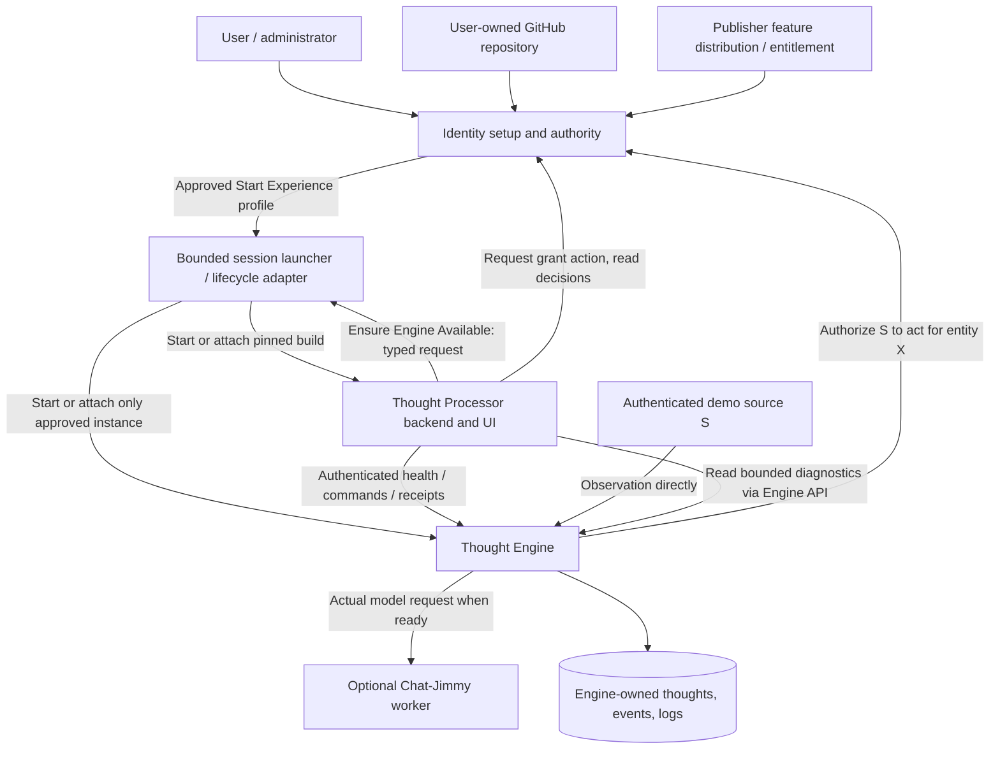
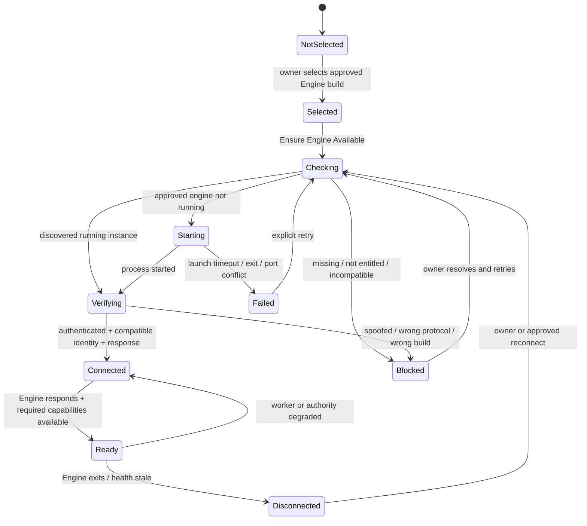

# Thought Processor ↔ Thought Engine: startup and control schematics

**Design proposal for owner review · 2026-10-24 · DOCUMENTATION ONLY / NOT IMPLEMENTED**

**Owner's question:** When Identity finishes the required GitHub-backed first-opening setup and launches the correct Thought Processor, what exact responsibility and protocol bridges **Thought Processor** to **Thought Engine**? Define this seam before adding more features.

**Decision proposed here, not yet owner-accepted:** **Thought Processor owns the intent to make Engine available and operate it. A narrow lifecycle adapter owns the actual process start/attach/stop. Thought Engine remains independently executable, authenticates operations, enforces Identity's runtime grants, and owns thought data.** The adapter may later delegate to native OS service managers without redesigning the Engine protocol.

**Governing rule:** Identity decides; Thought Engine enforces; Thought Processor connects, tests and explains.

**Related work:** [Interactive first Experience #9](https://github.com/Arameair/Thought-Processor/issues/9); [authorization integration #8](https://github.com/Arameair/Thought-Processor/issues/8); [Identity Start Experience #16](https://github.com/Arameair/identity/issues/16); [Identity grant #15](https://github.com/Arameair/identity/issues/15); [Engine grant enforcement experiment](https://github.com/Arameair/Thought-engine/tree/experiment/identity-grant-enforcement-20261024); [GitHub-owned bootstrap owner direction](https://github.com/Arameair/identity/blob/experiment/github-owned-bootstrap-notes-20261024/docs/GITHUB_OWNED_BOOTSTRAP_AND_FEATURE_ACCESS_2026-10-24.md).

No Alpha, Stable or Main promotion is requested. This proposal does **not** create a working Processor. The Thought-engine code branch has Engine-side Identity checks but **no verified live Identity grant endpoint**. Do not label the authorization stage as implemented.

## 1. Why this boundary matters

**Do not confuse these four questions:**

1. **Access to feature:** Has the publisher allowed this user to obtain the selected Engine build? This belongs to a publisher-controlled delivery/entitlement boundary, **not** an editable flag in local Identity or Processor.
2. **Installation and start:** Is the expected build present, and is the process actually running? The lifecycle adapter can ensure availability; this **does not** authorize an observation.
3. **Trusted service identity:** Is the responding process the registered Engine with the expected protocol and executable provenance? A local listening port or claimed `service_id` is insufficient.
4. **Runtime authorization:** Is authenticated source S allowed to submit `thought.observation.ingest` for entity X at Engine E **now**? Identity owns the grant; Engine checks and enforces it.

**The first-launch product journey changed:** GitHub connection and creation/selection of a **user-owned repository containing approved starter software** (with origin/credit) are now required before normal product operation. Restricted setup/repair screens can exist while GitHub is unavailable. Earlier docs treating GitHub as optional for a full product experience are superseded for this proposal; do not silently bypass the GitHub gate. The publisher feature-access check is separate from Identity's local grants.

## 2. System schematic: who speaks to whom



**Important:** The Source→Engine event path remains **direct**, independent of Processor. Engine's worker calls remain its own. Processor is the operator's control point, **not** a proxy for every observation or model token. Actual diagnostic data is obtained through authenticated Engine-owned endpoints, not by allowing Processor raw filesystem access just because both run locally.

The launcher is **one bounded component** shared by the session, even though Identity authorizes its initial creation and Processor requests Engine availability from it. Do not build two incompatible process managers in Identity and Processor. In version one, this may be a small local helper with a fixed manifest and no general-purpose command shell. Its ownership and lifetime survive closing the browser tab.

## 3. First-opening and startup sequence

```mermaid
sequenceDiagram
    actor Owner
    participant Identity
    participant Launcher as Session Launcher
    participant Processor
    participant Engine
    Owner->>Identity: Open setup
    Identity->>Owner: Connect GitHub and verify user-owned starter repository
    Identity->>Owner: Show publisher feature access and selected pinned demo builds
    Owner->>Identity: Approve "Start Experience"
    Identity->>Launcher: Begin bounded session (approved manifest)
    Launcher->>Processor: Start/attach approved Processor build
    Processor-->>Launcher: Real instance/protocol/build response
    Launcher-->>Identity: Processor READY or explicit error
    Identity-->>Owner: Open verified Processor workspace
    Processor->>Launcher: Ensure Engine Available (expected service, SHA, run ID)
    alt Exact Engine already running
      Launcher->>Engine: Inspect / authenticate / verify build and health
      Launcher-->>Processor: ATTACHED, ownership=external
    else Engine stopped but approved executable present
      Launcher->>Engine: Start approved executable in isolated profile
      Launcher->>Engine: Inspect / authenticate / verify build and health
      Launcher-->>Processor: STARTED, ownership=session
    else Build missing / mismatch / failed
      Launcher-->>Processor: MISSING / INCOMPATIBLE / FAILED with reason
    end
    Processor-->>Owner: Real Engine connection/readiness; grant is separate
```

**When does Processor signal Engine?** After Processor itself is running, has the verified Identity/session profile, and knows which exact Engine candidate is permitted, its backend issues **Ensure Engine Available**. This may happen automatically inside the *already approved* Start Experience session, because the owner previously saw and approved the list of exact services. It must not happen when someone merely opens Identity or browses a page without consent.

**Returning user:** reuse verified existing GitHub repository/installation and pinned selected build; do not create a new repo, service ID or child process on every launch. If GitHub becomes unavailable after a previous successful setup, show the stale/unavailable verification state, allow only explicitly selected repair/diagnostics, and do not invent policy to automatically stop already-running local services.

## 4. The two interfaces (keep separate)

### 4A. Processor → Session Launcher (lifecycle plane)

These are **proposed local interfaces**, not current endpoints:

```json
{
  "operation": "ensure_running",
  "request_id": "req-example-01",
  "session_id": "demo-example",
  "service_id": "registered-engine-E",
  "expected_artifact_sha256": "verified-artifact-hash",
  "expected_source_commit": "approved-git-sha",
  "profile_id": "demo-profile",
  "start_if_stopped": true
}
```

Proposed result:

```json
{
  "operation_id": "op-example-01",
  "outcome": "started",
  "ownership": "session",
  "instance_id": "run-example-01",
  "pid": 12345,
  "endpoint": "http://127.0.0.1:7798",
  "readiness": "starting",
  "reason": null
}
```

Outcomes: `attached`, `started`, `not_installed`, `incompatible`, `failed`, `unauthorized_launch`, `uncertain`. A successful **start** means a process exists; it does **not** mean **Engine ready**. Follow with verified health/readiness check. If a previously-running Engine is detected, **authenticate and compare** rather than trusting a process name, PID, port or self-reported SHA.

**Launcher guardrails:**

- Only allow commands from the **explicitly approved local manifest** (executable absolute path + digest, args allowlist, data root, environment/secret reference, port policy and expected service/protocol), with **no arbitrary shell command or repo cloning** through the Ensure endpoint.
- GitHub verification and publisher access determine whether a **new restricted build** may be obtained; the launcher does not mint entitlement.
- Same-host, loopback-only for the first test; separate host/WSL/VM deployment remains a different transport/trust design.
- Track **owned vs attached**. Never kill, rebuild or overwrite a preexisting independently running Engine just because a demo is stopped.
- Treat ensure_running as **idempotent** for (session, service, approved build). Concurrent button presses must not spawn two Engine instances. Reconnect after Processor crash must reconcile existing instance/run IDs.
- Persist a bounded session ownership record outside repo checkouts so abandoned child processes can be identified; the user's durable identity/Engine data are not deleted by Stop Demo.
- Shutdown: `stop_demo` stops only **session-owned** children after an explicit user action, with graceful termination → bounded timeout → explicitly recorded escalation; cannot indiscriminately `kill by port` or `kill by name`.
- Closing the **browser tab** stops neither Processor backend nor Engine. If Processor **backend** dies, a separately living session launcher does not automatically kill Engine; the next Processor can reconnect. Lifetime after the full demo session ends is user-selected and visibly reported.
- Owner-approved build pin must include **both source commit and actual built artifact digest**, because a binary's self-reported commit string cannot independently prove its origin.

### 4B. Processor → Thought Engine (operational plane)

Use a **small, versioned, authenticated HTTP/JSON contract for v1**. Engine already has Go loopback HTTP and `GET /api/status` in its experiment. The following fields are **proposed additions**, not a claim that current Engine returns them or authenticates every endpoint.

```json
{
  "service": "thought-engine",
  "protocol_version": "thought-engine.control.v1",
  "service_id": "registered-engine-E",
  "instance_id": "run-example-01",
  "source_commit": "approved-git-sha",
  "runtime": {"pid": 12345, "port": 7798},
  "engine_state": "ready",
  "authority_state": "identity_connected",
  "worker_state": "unavailable",
  "capabilities": ["health", "diagnostics", "observation.receipts"]
}
```

**Proposed minimum operations:**

| Operation | Authority / ownership | Returns |
| --- | --- | --- |
| `GET /api/status` (existing partial) | Engine | Health/worker state; extend with protocol, instance, capability and real authority-check evidence |
| `GET /api/diagnostics` (existing partial) | Engine | Bounded logs/metrics, exact commit, errors; redact sensitive contents |
| `GET /api/entities/{id}` (existing partial) | Engine | Actual observations, Sparks/Traces/Thoughts for authorized entity |
| `POST /api/entities/{id}/events` (existing) | **Authenticated Source** → Engine | 202 queue receipt / 401 sender unknown / 403 Identity deny / 503 Identity unavailable |
| Proposed `GET /api/operations/{id}` | Engine | Correlated queued/running/succeeded/refused/failed event evidence |
| Proposed scoped control commands (pause, process-once, retry) | Authenticated Processor → Engine **and** applicable Identity authorization | Explicit operation receipt; require per-operation grant, not a blanket dashboard permission |

**Do not enable broad writable Engine operations merely because Processor is connected.** Its existing local endpoints are not a production authorization system, and `/api/status` itself is not enough to verify service identity. Define authenticated pairing against Identity and least-privilege data reads before showing private prompts, entities or thoughts.

## 5. Handshake and state machine

### Processor knows the difference between running and ready



Treat these as **separate status dimensions**, not a single green dot:

1. **Installation/build:** selected, present, hash verified, installed, incompatible.
2. **Process:** stopped, starting, running, exited; ownership is session vs external.
3. **Connection/trust:** discovered, authenticated, compatible, disconnected, stale.
4. **Permission:** unverified, no grant, Identity approved, revoked, authority unavailable.
5. **Worker:** unconfigured, ready, busy, unavailable, blocked, mock/test only.

An Engine can be **running and connected** while the model worker is **unavailable**. It can be healthy for diagnostics while **unauthorized to process observations**. An Identity outage is not the same as explicit grant denial.

## 6. Runtime authorization and observation sequence (separate from startup)

```mermaid
sequenceDiagram
    actor Owner
    participant Processor
    participant Identity
    participant Source as Demo Source S
    participant Engine
    participant Worker as Optional AI Worker
    Owner->>Processor: Request one scoped grant for entity X and source S
    Processor->>Identity: Authenticated owner-approved grant action
    Identity-->>Processor: Grant ID/version or explicit refusal
    Owner->>Processor: Try one observation
    Processor->>Source: Ask authenticated test source to send event
    Source->>Engine: Authenticated POST /api/entities/X/events
    Engine->>Identity: Fresh auth check (S, E, X, ingest)
    alt Allowed
        Identity-->>Engine: Authenticated signed ALLOW + decision ID
        Engine-->>Source: 202 QUEUED + event receipt
        Engine->>Identity: Recheck before worker call
        Identity-->>Engine: Current decision
        opt Allowed and real worker ready
            Engine->>Worker: Actual model request
            Worker-->>Engine: Actual reply
            Engine->>Identity: Fresh check before commit
            Identity-->>Engine: Current decision
            Engine->>Engine: Store actual Spark/Trace/Thought evidence
        end
    else Denied or revoked
        Identity-->>Engine: DENY
        Engine-->>Source: 403; no new model call
    else Identity unreachable
        Engine-->>Source: 503; no new model call
    end
    Processor->>Engine: Read correlated receipt, queue and worker counts
    Processor-->>Owner: Actual timeline or explicit incomplete status
```

**Strong boundary:** start/attach is a lifecycle operation, not a grant. A signed grant is not publisher permission to redistribute Engine code. The source identity must be authenticated independently of `source: "tass"` in the payload.

**Existing Engine candidate:** [Identity gate experiment](https://github.com/Arameair/Thought-engine/blob/experiment/identity-grant-enforcement-20261024/docs/IDENTITY_AUTHORIZATION_EXPERIMENT_2026-10-24.md) contains draft Engine-side checks and a test fixture; tests and live Identity interoperability remain unverified. For the first experiment, no offline cached ALLOW; fail closed for new protected events when Identity is unreachable. Do **not** silently run Engine legacy grant mode and call it an Identity-enabled demo.

## 7. What the user actually sees

Keep it to one calm workspace; do not begin with an all-feature dashboard:

```text
THOUGHT PROCESSOR           Profile: First Experience     Run: <run ID>
Working identity: <name + durable ID> | Repo: <verified user-owned repository>

ENGINE
  Build: <branch / exact SHA / artifact digest>
  Process: STARTED BY DEMO / ATTACHED TO EXISTING
  Connection: AUTHENTICATED / INCOMPATIBLE / LOST
  Authorization: NO GRANT / ALLOWED / REVOKED / IDENTITY UNAVAILABLE
  Worker: READY / UNAVAILABLE
  [Reconnect] [Open Engine UI] [Logs] [Metrics]

TRY IT
  [Select one verified demo source S]
  [Request approval via Identity] [Revoke via Identity]
  Observation: "The player returned to Goldshire."
  [Send one observation]

WHAT HAPPENED (real receipts only)
  01 Source authentication -> valid/failed
  02 Identity decision -> allow/deny/unavailable (+ decision ID)
  03 Engine intake -> 202 / 403 / 503 (+ event ID)
  04 Worker -> actually sent / not sent / unavailable
  05 Result -> Spark/Trace/Thought/none, with explanation
  [Copy Context] [Copy Logs] [Stop Demo]
```

UI actions remain disabled if an authenticated capability is missing. Only one expanded original feature UI at a time. Include requested/accepted/observed status, timestamps, branch, full SHA, PID/port, error, worker-call count and rollback. Copy Context defaults to **sanitized metadata**, not credentials or private observation text.

## 8. Failure matrix and lifecycle rules

| Scenario | Expected truthful outcome |
| --- | --- |
| No GitHub connection on first open | **SETUP / REPAIR ONLY**; do not claim full product readiness or create customer repo without consent |
| GitHub/repository verified, publisher denies access to new Engine build | **NOT ENTITLED / DELIVERY BLOCKED**; do not fetch restricted artifact; do not claim you can retroactively erase already installed code |
| Processor starts; Engine not installed | **NOT INSTALLED** with specific build requirement; no fake READY |
| Correct Engine already running | **ATTACH**, verify service, protocol and executable origin; no second process |
| Engine port occupied by another process | **PORT CONFLICT** / different service; do not kill or treat HTTP 200 as proof |
| Engine starts then exits | **FAILED**, retain exit code and bounded stderr; session cleanup only |
| Engine responding but wrong API version | **INCOMPATIBLE**, no privileged calls |
| Processor browser UI closes | Engine/Processor backend keep running; user can reopen |
| Processor backend exits | Session launcher preserves owned Engine until explicit Stop Demo / documented end-of-session policy; reconnect by recorded instance |
| Identity grant denied or revoked | Engine refuses protected observation; Processor still can show authorized diagnostics |
| Identity unreachable | **AUTHORITY UNAVAILABLE**; new protected operations fail closed in first experiment |
| Engine worker not ready | Engine may queue an already-authorized event; display **QUEUED / WORKER UNAVAILABLE**; never fabricate a Thought |
| Stop Demo | End only explicitly session-owned processes; leave independently started ones and durable data alone |
| Lost owner access to selected GitHub repo on returning run | **REPAIR**; do not automatically duplicate repo, migrate user identity or destroy running local data |

## 9. Narrow acceptance tests before expanding system schematics

**Phase A — process bridge (no pretending authorization):**
- Start Identity after GitHub-backed setup; approve Start Experience with exact pinned Processor and Engine.
- Processor runs and asks launcher `ensure_running`; verified Engine starts or attaches.
- Run `ensure_running` again and concurrently: **same Engine instance**, not duplicate.
- Close Processor *browser tab*: Engine still running. Restart Processor backend and reconnect if launcher survives.
- Wrong binary/protocol/port gives blocked diagnostic, never false authentication.
- Stop Demo cleans **only session-owned** processes and preserves Engine data.

**Phase B — real trust + permission:**
- Identity recognizes service IDs and exposes real owner-approved grants (the endpoint is currently missing).
- Engine checks Identity at intake, queue dispatch and before commit. Allow exactly S→E for X; wrong source and entity denied.
- Revoke grant without restarting Engine; next protected observation refused.
- Stop Identity: 503, zero additional model calls; no fallback to local Engine ON flag.

**Phase C — small cognitive experience:**
- Send one deliberately chosen observation from authentic demo source; see real persisted receipt.
- If a genuine Chat-Jimmy worker is ready, show actual model call and result; otherwise show worker unavailable.
- Send up to two related examples **only after** the first verified event. No fabricated Sparks or Thoughts.

**Status:** ALL TESTS ABOVE ARE **NOT RUN** by this document. Request measured evidence for each stage: exact repository SHA, built digest, OS, request IDs, process/run IDs, startup duration, auth latency, worker count, errors and rollback. Fixtures labeled visibly.

## 10. Keep these decisions open

1. **Physical launcher location:** separate process managed by Identity vs Processor-owned adapter. Recommendation for this small demo: **one session-scoped launcher created from Identity's approved Start Experience and callable by Processor**, so Processor restarts do not orphan Engine; later delegate to OS service managers.
2. **Lifetime policy:** session-owned Engine survives browser closing and temporary Processor backend exit; exact behavior after logout or computer restart remains future work.
3. **Authentication transport:** first test same-host loopback with explicit trusted pairing/credentials; do not assume loopback alone is trustworthy. Production IPC (Unix socket / Windows named pipe / OS service manager) is a separate decision.
4. **Packaging:** independent Engine and Processor binaries vs one feature bundle with separate runtime services. Both are compatible with this interface; licensing/delivery implications still need owner choice.
5. **GitHub outage:** mandatory first-use account/repository gate is owner direction; returning-run offline policy is not settled. Do not auto-kill existing processes or pretend an expired login is verified.
6. **Publisher entitlement semantics:** controls *new publisher-distributed access* as implemented at a trustworthy boundary, not Engine's local entity grants or revocation of code already delivered.
7. **Security scope of diagnostics:** current Engine read endpoints are not yet a secure multiuser interface. Restrict them pending paired/scoped reads.
8. **Exact protocol fields:** typed drafts above need tests and agreement with the Identity/Engine teams before becoming frozen public API.

## Builder request / review questions

**Thought Processor team:** On an experimental branch from current Alpha, implement the smallest runnable Processor with truthful status and the `ensure_running` handshake to the one selected [Thought-engine experiment](https://github.com/Arameair/Thought-engine/tree/experiment/identity-grant-enforcement-20261024). Coordinate ownership of the **single** bounded launcher with Identity. Prove attached vs started vs missing vs crashed vs incompatible before building a large UI.

**Identity team:** Provide a verified, publisher-access-aware launch profile for the **user-owned GitHub starter repo**, then the real authenticated grant check separately. Normal product operation cannot silently skip GitHub setup; repair remains possible.

**Engine team:** Expose a verifiable service/protocol/runtime identity, compatible health/diagnostics and authentic intake; preserve standalone Engine execution. Do not assume Processor is available when checking a grant or calling workers.

**Owner review:** Does the Processor have the right amount of lifecycle control? Would one Start Experience action be preferable to separate processor/engine start buttons? What exact running Engine lifetime is expected after leaving the app?

No implementation, tests or promotions occurred by writing these schematics. Credit: human-directed architecture prepared with AI assistance.
